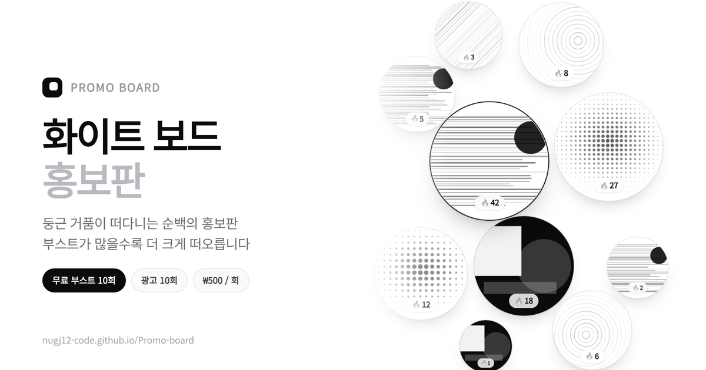

# 화이트 보드 홍보판

부스트가 많을수록 **더 크게** 떠오르는, 순백(#FFFFFF)의 공유 홍보판입니다.
홍보 이미지는 **투명한 유리 거품**이 되어 캔버스 위를 자유롭게 떠다니고,
거품을 누르면 올린 사람이 **직접 쓴 설명**이 크게 나타납니다.

- **라이브**: <https://nugj12-code.github.io/Promo-board/>
- **저장소**: <https://github.com/nugj12-code/Promo-board>
- **백엔드**: Supabase (Postgres + Realtime + Storage) — 실시간 공유
- **호스팅**: GitHub Pages (정적 파일 하나로 동작)



---

## 1. 어떻게 동작하나요

### 화면에는 보드만 남습니다

- 왼쪽 위에는 아무 글자도 없습니다(제목·부스트 안내 문구 없음). 오른쪽 위에 연결 상태와 카드 개수만 작게 붙습니다.
- 오른쪽 아래 검은 버튼은 **`+ 홍보하기`** 이고, 빈 보드에서는 가운데 **`첫 홍보하기`** 버튼이 나옵니다.
- 보드에 올린 이미지는 **사진이 비쳐 보이는 유리 거품**이 됩니다(사진 불투명도 0.76, 마우스를 올리면 0.92).
  거품에는 얇은 유리 림과 비눗방울 하이라이트가 있고, 그림자도 아주 옅습니다.

### 거품을 누르면 직접 쓴 설명이 나옵니다

- 거품을 클릭/탭하면 상세 모달이 열리고, 제목 아래 **`직접 쓴 설명`** 카드에 올린 사람이 쓴 글이 15.5px 본문 색으로 크게 나옵니다.
- 설명을 비워 두고 올렸다면 `작성된 설명이 없어요.` 로 표시됩니다.
- 올릴 때 입력하는 칸의 이름도 **`직접 쓴 설명`** 입니다(선택 · 200자).

### 내 홍보와 다른 사람 홍보

| 누가 보나 | 무엇이 보이나 | 어떻게 올리나 |
| --- | --- | --- |
| **내 홍보** (이 브라우저에서 올린 카드) | `내 홍보` 배지 + `🔥 내 홍보 키우기` | 무료 10회 → 광고 10회 → ₩500 |
| **다른 사람 홍보** (그 밖의 모든 카드) | `🤝 같이 홍보하기 (무료 N회 남음)` | **5회까지 무료 → 6회부터 5초 광고** |

- 내가 올린 카드의 id는 `localStorage` 의 `promo_board_owned_ids` 에 남습니다. 그래서 **남의 홍보에는 주인용 부스트 버튼이 아예 나오지 않습니다.**
- 같이 홍보하기 사용 횟수는 `promo_board_cobooost_v1` 에 브라우저 단위로 기록됩니다(카드별이 아님).
  5회를 다 쓰면 버튼이 **`광고 보고 같이 홍보하기`** 로 바뀌고, 5초 광고를 끝까지 봐야 `boost_count` 가 1 올라갑니다.
- 둘 다 기존 `increment_boost` RPC 를 그대로 씁니다.

### 부스트가 거품의 크기를 정합니다

거품 지름은 부스트 횟수의 **로그 곡선**(`0.46 + 0.175 × log₂(1 + 부스트)`)을 따라 커집니다.
단계로 끊기지 않아서 **한 번 올릴 때마다 조금씩** 자라고, 많이 올린 거품은 확실히 커집니다.
화면 면적과 거품 개수에 맞춰 전체 반지름을 한 번에 맞추므로 작은 폰에서도 화면을 벗어나지 않습니다.

| 부스트 | 지름 (모바일 390px) | 지름 (데스크톱 1440px) |
| --- | --- | --- |
| 1 | 약 74px | 약 152px |
| 5 | 약 106px | 약 218px |
| 12 | 약 129px | 약 264px |
| 27 | 약 151px | 약 310px |
| 42 | 약 164px | 약 336px |
| 100+ | 약 190px | 약 390px |

> 위 수치는 거품 10개가 있을 때 기준입니다. 개수가 적으면 하나하나가 조금 더 커지고,
> 30개쯤 되면 전체가 작아져 서로 부딪히지 않게 자리를 나눕니다.

### 캔버스는 거품이 떠다니는 물리 공간입니다

- 순백(`#FFFFFF`) 캔버스가 헤더 아래 화면 전체를 채웁니다(스크롤 없음).
- 모든 거품은 `requestAnimationFrame` 루프에서 **아주 느긋하게(초당 8–20px) 곡선으로 표류**합니다.
- 가장자리에서는 부드럽게 튕기고, 서로 닿으면 **밀어내며** 겹쳐 쌓이지 않습니다.
- 크기 변화(부스트)는 목표 반지름으로 부드럽게 이어지고, 새 거품은 살짝 작게 시작해 부풀어 오릅니다.
- 마우스를 올리면 그 거품만 느려져서 클릭하기 편합니다(모달이 열린 동안은 전체 정지).
- `prefers-reduced-motion: reduce` 에서는 움직이지 않고 자리만 잡습니다.

### 부스트는 3단계입니다 (내 홍보 · 한 사람 기준)

| 단계 | 횟수 | 방식 | 화면 문구 |
| --- | --- | --- | --- |
| 1 | 1–10회 | **무료** | `남은 무료 부스트 N/10` |
| 2 | 11–20회 | **광고 시청** (최대 10회, 5초) | `광고 보고 키우기 N/10` |
| 3 | 21회~ | **소액 결제** (₩500 / 1회) | `₩500/회` |

- 무료 10회를 다 쓰면 자동으로 광고 단계로, 광고 10회까지 다 쓰면 결제 단계로 넘어갑니다.
- 내가 쓴 부스트 횟수는 이 브라우저(`localStorage` 의 `whiteboard.mine.v1`)에 카드별로 기록됩니다. 기기를 바꾸면 무료 10회가 새로 시작합니다.

### 실시간 공유

Supabase `promo_items` 테이블의 변경(INSERT/UPDATE/DELETE)을 Realtime으로 구독합니다.
누군가 카드를 올리거나 부스트하면 접속 중인 모든 화면의 거품 크기가 즉시 바뀝니다.

---

## 2. 처음 한 번만 하면 되는 설정

### ① Supabase SQL 실행 (필수)

1. <https://supabase.com/dashboard> 에서 이 프로젝트를 엽니다 — `xvsutfyxxtkcxxbixgan`
2. 왼쪽 **SQL Editor** → **New query**
3. 이 저장소의 [`supabase_schema.sql`](supabase_schema.sql) **전체**를 붙여넣고 **Run**
   (여러 번 실행해도 안전합니다. 테이블·RPC·Realtime·Storage 버킷·정책이 한 번에 만들어집니다.)
4. 맨 아래 결과가 `promo_items_count | bucket_ok` 로 나오면 성공입니다.

> SQL을 실행하기 전에 사이트를 열면 상단에 **"DB 초기화 대기 중"** 안내가 뜨고 예시 카드로 미리 볼 수 있습니다.
> SQL을 실행하면 8초 안에 자동으로 실시간 공유 보드로 전환됩니다. (또는 안내의 **다시 확인** 버튼)

### ② Supabase 키 (이미 입력되어 있습니다)

`index.html` 맨 위 `CONFIG` 에 값이 들어 있습니다.

```js
const CONFIG = {
  SUPABASE_URL: 'https://xvsutfyxxtkcxxbixgan.supabase.co',
  SUPABASE_ANON_KEY: 'sb_publishable_...',   // 공개되어도 되는 anon(publishable) 키
  BUCKET: 'board-images',
  ...
};
```

다른 프로젝트로 옮길 때만 이 두 값을 바꾸면 됩니다.
값이 `YOUR_SUPABASE_URL` 같은 자리표시자면 앱이 자동으로 **로컬 체험 모드**로 열립니다.

> `anon` / `publishable` 키는 브라우저에 노출되는 공개 키입니다. 실제 접근 제어는 `supabase_schema.sql` 의 RLS 정책이 담당합니다.
> `service_role` 키는 절대 이 파일에 넣지 마세요.

### ③ GitHub Pages 켜기

1. <https://github.com/nugj12-code/Promo-board/settings/pages>
2. **Build and deployment → Source**: `Deploy from a branch`
3. **Branch**: `main` / 폴더 `/(root)` → **Save**
4. 1–2분 뒤 <https://nugj12-code.github.io/Promo-board/> 가 열립니다.

---

## 3. 광고 · 결제를 실제로 붙이는 곳

지금은 **미리보기(테스트)** 상태이고, 실제 광고/결제는 일어나지 않습니다.
아래 두 곳의 `TODO` 주석 자리에만 연결하면 됩니다.

### 리워드 광고 (2단계)

- `index.html` 의 `startAd()` / `finishAd()` 근처
- 광고 영역 DOM: `<div class="adbox" id="adBox">`
- `/* TODO: AdSense / Rewarded Ad SDK hook */`
- 광고 로드 실패·중간 이탈 시에는 `finishAd()` 를 호출하지 않도록 하고, 사용자에게 "광고를 끝까지 봐야 부스트가 올라가요"를 보여 주세요.

### 결제 (3단계)

- `index.html` 의 `#payBtn` 클릭 핸들러
- `/* TODO: Toss Payments / Stripe / Ko-fi hook */`
- `CONFIG.TOSS_CLIENT_KEY` 에 키를 넣으면 결제 모달의 "테스트 모드" 문구가 "결제 모듈 연결됨"으로 바뀝니다.
- **중요**: 결제 승인은 서버에서 검증한 뒤 부스트를 올려야 합니다.
  브라우저에서 결제 성공 콜백만 믿고 부스트를 올리면 조작될 수 있습니다.
  (권장 흐름: 결제 승인 → Supabase Edge Function 이 `service_role` 로 `boost_count` 증가)

---

## 4. 파일 구조

```
index.html            앱 전체 (HTML + CSS + JS, 의존성 없음 · supabase-js만 CDN)
supabase_schema.sql   DB · RPC · Realtime · Storage 한 번에 설정 (idempotent)
og.png                1200×630 미리보기 이미지 (OG 태그에도 사용)
live-preview.png      실제 라이브 화면 캡처 (모바일 390×844)
.nojekyll             GitHub Pages 가 파일을 그대로 서빙하도록
README.md             이 문서
```

`index.html` 안의 큰 구획:

| 위치 | 내용 |
| --- | --- |
| `<style>` | 순백 모노크롬 디자인, 거품/모달/반응형 |
| `CONFIG` | Supabase URL·키, 부스트 정책, 광고/결제 훅 자리 |
| `sizeFactor()` | 부스트 → 거품 반지름 계수(로그 곡선) |
| `computeRadii()` | 화면 면적·거품 개수에 맞춘 반지름 계산 |
| `stepMotion()` | 거품 물리: 표류·충돌·벽 반사 |
| `render()` | 거품 생성·갱신과 초기 배치(황금각 나선) |
| `boostState()` | 내 홍보의 무료/광고/결제 판정 |
| `isOwned()` / `markOwned()` | 이 브라우저에서 올린 홍보인지 판단 (`promo_board_owned_ids`) |
| `coBoostNow()` | 남의 홍보에 같이 홍보하기 (+1, `promo_board_cobooost_v1` 기록) |
| `applyBoost()` | 화면 반영 + `increment_boost` RPC 호출 |
| `connectCloud()` | Supabase 조회·구독, 테이블 없을 때 대기 처리 |

---

## 5. DB 구조

```sql
promo_items
  id          uuid primary key default gen_random_uuid()
  title       text        not null      -- 1~60자
  description text        not null default ''
  link_url    text                      -- http(s)만 허용
  image_url   text        not null
  boost_count integer     not null default 1   -- 1 이상
  created_at  timestamptz not null default now()
```

- **RLS**: 누구나 `select`, 누구나 `insert` (단, `boost_count = 1` 로만 생성 가능 → 부스트 수 조작 방지)
- **RPC**: `increment_boost(item_id uuid, amount integer default 1)` — `security definer`, `amount` 는 1만 허용, 반환값은 새 `boost_count`
- **Realtime**: `promo_items` 의 INSERT/UPDATE/DELETE 를 구독
- **Storage**: `board-images` 버킷 (공개 읽기, 누구나 업로드, 5MB, jpg/png/webp/gif)

---

## 6. 로컬에서 미리 보기

```bash
# 그냥 열기 (file:// 로도 동작합니다)
open index.html

# Supabase에 붙지 않고 이 브라우저에서만 (예시 카드 + localStorage)
open "index.html?local=1"

# 저장된 카드·부스트 기록·내 홍보/같이 홍보 기록 초기화
open "index.html?reset=1"
```

`?local=1` 은 디자인/동작을 확인할 때, `?reset=1` 은 보드를 처음 상태로 되돌릴 때 씁니다.
`?reset=1` 은 내 홍보 목록(`promo_board_owned_ids`)과 같이 홍보 횟수(`promo_board_cobooost_v1`)도 함께 지웁니다.
그래서 초기화 뒤에는 예시 카드가 모두 "다른 사람 홍보"로 보입니다.

---

## 7. 운영 메모 (공개 서비스로 키울 때)

- **소유자 판단**: "내 홍보"는 이 브라우저의 `localStorage`(`promo_board_owned_ids`)로만 판단합니다.
  기기를 바꾸거나 저장소를 지우면 내가 올린 카드도 "다른 사람 홍보"로 보입니다(같이 홍보하기 5회 무료부터).
  서버 기준으로 확실히 하려면 Supabase Auth 의 `user_id` 를 카드에 저장하고 그걸로 판단하세요.
- **부스트 남용**: `increment_boost` 는 익명 호출이 가능합니다. 무료/광고/결제 단계는 브라우저에서 판단하므로,
  진짜로 막으려면 사용자 식별(Supabase Auth 또는 익명 세션)과 서버 측 한도(RPC 안에서 하루/카드별 횟수 제한, 또는 Edge Function)가 필요합니다.
- **이미지 검수**: 누구나 업로드할 수 있으므로 공개 게시 전 검수나 신고 기능을 두는 것을 권합니다.
  (Storage 정책에 `image/*` MIME 제한은 이미 걸려 있습니다.)
- **용량**: Supabase 무료 플랜은 Storage 1GB · DB 500MB 입니다. 업로드 이미지는 브라우저에서 최대 1600px 로 줄여 올립니다.
- **삭제**: 지금은 삭제 UI가 없습니다. 필요하면 `promo_items` 에 `delete` 정책과 카드 메뉴를 추가하세요.
  (익명 사용자끼리 남의 카드를 지우지 못하도록 소유자 개념이 먼저 필요합니다.)

---

## 8. 검증 기록

**투명 거품 · 홍보하기 · 같이 홍보하기 개편** (2026-11-27, 헤드리스 Chrome — 390×844 모바일 / 1440×900 데스크톱)

- 왼쪽 위 `화이트 보드 홍보판` 제목·아이콘·부스트 안내 문구 삭제 → 헤더에 브랜드 노드 0개, 오른쪽 상태/개수만 남음
- 오른쪽 아래 버튼 `+ 홍보하기`, 빈 보드 CTA `첫 홍보하기`
- 거품 스타일: 사진 `opacity: .76`(호버 `.92`), 테두리 0px · 배경 투명, `::before` 유리 림(inset 1px + 안쪽 광택),
  `::after` 반사광, 그림자 `0 16px 34px -26px rgba(10,10,12,.30)` — 계산된 스타일로 확인
- 거품 11개가 표류 · **60fps** · 3초 샘플링 겹침 0px · 캔버스 밖 이탈 0
- 거품 클릭 → 상세 모달: `직접 쓴 설명` 라벨 + 글쓴이 설명 15.5px 본문 색(빈 설명은 `작성된 설명이 없어요.`) · 설명이 버튼보다 위
- 남의 홍보(예시 카드): 주인 컨트롤 숨김 · `🤝 같이 홍보하기 (무료 5회 남음)`
  → 5회 연속 사용 시 문구가 `무료 4→1회 남음` 으로 줄고 매번 `boost_count +1`,
  5회를 쓰면 `광고 보고 같이 홍보하기` + `광고 5초` 로 전환 (localStorage `{"used":5}`)
  → 6번째는 5초 광고 모달을 거쳐 +1 (`{"used":6}`), 새로고침 뒤에도 유지
- 내 홍보(직접 업로드): `내 홍보` 배지 · `🔥 내 홍보 키우기` · 무료 10회 → 9회로 감소 · 같이 홍보 버튼 숨김
- `?reset=1` 초기화가 내 홍보·같이 홍보 기록도 지움 · `prefers-reduced-motion` 에서 이동 0px · 콘솔 에러 0 · 실패 요청 0
- 헤더 높이가 바뀌어도(상태 배지 표시) 보드 높이를 다시 재도록 `ResizeObserver` 추가 — 하단 이탈 0

**거품 캔버스 개편** (2026-11-27, 헤드리스 Chrome — 390×844 모바일 / 1440×900 데스크톱)

- 배경 `rgb(255,255,255)` 순백 캔버스, 거품 `border-radius: 50%` · 이미지 `object-fit: cover`, 예시 카드 10개 렌더
- 부스트가 많을수록 큼 — 지름 모바일 74px(부스트 1)~164px(42) / 데스크톱 152px~336px
- 부스트 1회 → 그 거품이 그 자리에서 자람 (모바일 73.8px → 84.9px, +15%) · 상세 모달이 열려 있어도 뒤에서 자람
- 1.4초 동안 거품이 5~32px 이동, **60–61fps** 유지
- 3초간 12회 샘플링에서 **겹침 최대 0px**, 캔버스 밖으로 나간 거품 0
- 움직이는 거품을 탭/클릭 → 상세 모달 열림(제목 일치) · 모달이 열린 동안 거품 위치 고정
- 거품 30개 스트레스 테스트: 겹침 0 · 이탈 0 · 60fps (지름 모바일 38~101px / 데스크톱 79~208px)
- `prefers-reduced-motion: reduce` → 1.5초 동안 이동 0px, 겹침 0
- 부스트 3단계 회귀 확인: 무료 10회 → 광고(5초 뒤 버튼 활성, 부스트 +1) → 결제(테스트, 부스트 +1) 전환 정상
- 이미지 파일 업로드(압축) → 11번째 거품 추가 → 새로고침 후 유지
- Supabase 실시간 모드: 배지 `실시간 공유 중 · Supabase` · DB 카드 1개가 거품으로 렌더 · 4xx/5xx 0 · 콘솔 에러 0
- **라이브 배포 확인** (2026-11-27, <https://nugj12-code.github.io/Promo-board/>): HTTP 200 · 배지 `실시간 공유 중 · Supabase`
  · 거품 1개(부스트 1 · 모바일 212px / 데스크톱 434px)가 표류 · 탭/클릭 시 상세 모달 정상 · 콘솔 에러 0
  · `live-preview.png` 는 이 라이브 화면(390×844) 캡처

**이전 검증 (그리드 보드 시점)**

- `node --check` — 인라인 스크립트 문법 검사 통과 (jsdom은 이 실행 환경에서 설치가 막혀, DOM 검증은 헤드리스 Chrome으로 수행)
- Headless Chrome (iPhone 390×844 / 데스크톱 1440×900)
  - 배경 `rgb(255,255,255)` 순백, 타일 10개 렌더
  - 부스트가 많을수록 타일이 큼 (모바일 113 / 237 / 362px, 데스크톱 212 / 441 / 671px)
  - 상세 모달 → 무료 10회 → 광고 5초 → 광고 10회 → 결제(₩500 테스트) 전 단계 전환
  - 이미지 업로드(압축 포함) → 보드에 추가 → 상세에서 링크 노출
  - 콘솔 에러 0
- Supabase 미초기화 상태에서 `DB 초기화 대기 중` 안내 + 예시 카드 표시 확인
- **라이브 배포 확인** (2026-11-27, <https://nugj12-code.github.io/Promo-board/>)
  - HTTP 200 · 배지 `실시간 공유 중 · Supabase` · Realtime 채널 `joined`
  - `promo_items` 조회 200 · `increment_boost` RPC 응답 확인 · `board-images` 버킷 공개 읽기 확인
  - 콘솔 에러 0 · 실패한 요청 0

> 배포 직후 보드는 비어 있습니다(테이블 0행). `+ 올리기`로 첫 카드를 올리면 그때부터 실시간 공유가 시작됩니다.
